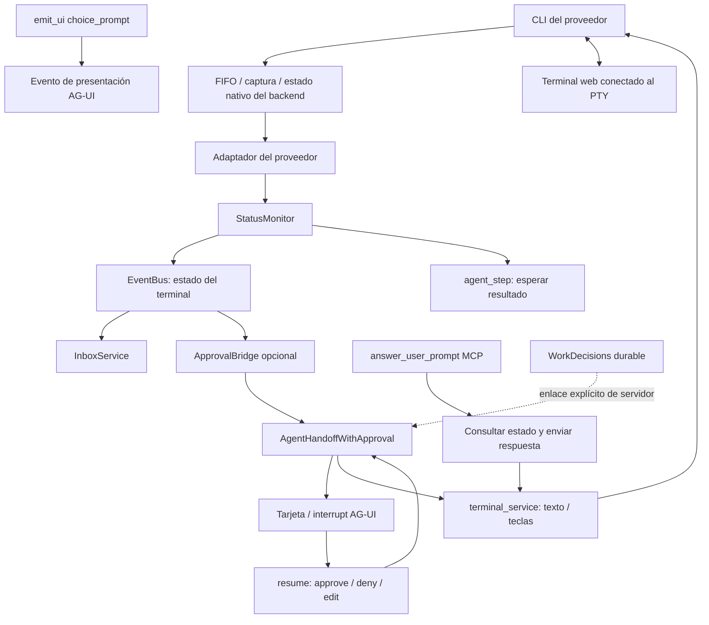

# Análisis de preguntas e interacciones de agentes

**Fecha**: 2026-10-09. **Alcance**: implementación local actual y requisitos de la feature 016.

Esta investigación distingue capacidades implementadas, limitaciones observadas en el código y decisiones propuestas. Las pruebas de caracterización no implementan la nueva funcionalidad. No se iniciaron agentes reales ni se usaron cuentas del operador.

## 1. Resultado de la investigación

CAO dispone de observación de terminales, detección de algunos estados de espera, respuestas explícitas mediante MCP y un flujo opcional de aprobaciones AG-UI. Esas piezas no forman un contrato común de pregunta, destinatario y respuesta. La prosa interrogativa permanece como salida; un diálogo nativo suele reducirse a un estado de terminal; `choice_prompt` publica presentación; los interrupts actuales aceptan decisiones de aprobación.

El problema atraviesa proveedor, transporte, orquestación, identidad del trabajo, autorización, persistencia, eventos e interfaz. Crear solamente una tarjeta o ampliar una expresión regular no cubre la entrega correcta de respuestas ni la recuperación.

La propuesta utiliza preguntas explícitas como base común y reconocimiento nativo solo cuando se acredita el diálogo activo y su forma de respuesta. El usuario recibe decisiones humanas; el supervisor puede contestar aclaraciones dentro de su autoridad. Cada respuesta permanece vinculada a la pregunta y trabajo que la originaron.

## 2. Método y límites de evidencia

- Se inspeccionó `git status`: había cambios en artefactos de Graphify y archivos no versionados de auditoría/grafos. Se conservaron.
- Se leyeron el flujo de trabajo, la constitución y la plantilla activa de Spec Kit. No hay `.specify/extensions.yml`; no se ejecutaron hooks ni se cambió de rama.
- Se consultó Graphify mediante `explain` para `ApprovalBridge`, `answer_user_prompt`, `emit_ui` y `WorkDecisions`, y `affected` para `AgentHandoffWithApproval` mediante su identidad única.
- El intento de `affected send_input` no resolvió un nodo único. No se tomó como ausencia de dependencias.
- El grafo señala `answer_user_prompt` en una línea distinta de la del fuente actual. Se usó para descubrir vecinos; los símbolos y rutas importantes se contrastaron leyendo el código. No se regeneró ni se sobrescribió el grafo preexistente.
- Se ejecutaron pruebas existentes de respuestas, bridge, clasificación, concurrencia de aprobaciones, decisiones durables, flujo AG-UI, política OpenCode y detección de permisos. Se ejecutó el control de composición del proyecto. Resultados y límites en [composition-review.md](composition-review.md).
- Las pruebas de transporte terminal utilizan dobles de HTTP/PTY. Las pruebas de aprobación durable incluyen SQLite real temporal. No acreditan teclas ni formatos de todas las versiones de CLI reales.

## 3. Mapa del sistema actual

`choice_prompt` no añade por sí mismo una arista de respuesta a la orquestación. El bridge recibe transiciones de estado, no una entidad de pregunta emitida por el proveedor.

Fuentes: [status_monitor.py](../../src/cli_agent_orchestrator/services/status_monitor.py), [approval_bridge.py](../../src/cli_agent_orchestrator/services/agui/approval_bridge.py), [handoff_approval.py](../../src/cli_agent_orchestrator/services/agui/handoff_approval.py), [server.py](../../src/cli_agent_orchestrator/mcp_server/server.py), [main.py](../../src/cli_agent_orchestrator/api/main.py).

## 4. Preguntas en prosa

`TerminalStatus` representa estado de terminal, sin tipo de pregunta, opciones, destinatario, versión o respuesta. `StatusMonitor._detect_status` delega en `provider.get_status` y aplica controles de prueba del turno. No existe un detector general que convierta una frase interrogativa en pregunta accionable.

Claude conserva expresamente las preguntas del asistente como texto de respuesta en `_strip_native_feedback_from_region`. El helper `BaseProvider._extract_questions` reúne preguntas de mensajes de usuario para un resumen de sesión; no enruta preguntas del asistente ni espera sus respuestas. Confundir ese helper con una función de interacción produciría una conclusión incorrecta.

En una delegación, texto interrogativo extraído como resultado final puede llegar al supervisor como resultado ordinario. Que llegue no equivale a mantener una tarea pendiente de decisión. La interpretación y el siguiente mensaje recaen entonces en el agente supervisor.

Fuentes: [terminal.py](../../src/cli_agent_orchestrator/models/terminal.py), [base.py](../../src/cli_agent_orchestrator/providers/base.py), [claude_code.py](../../src/cli_agent_orchestrator/providers/claude_code.py), [agent_step.py](../../src/cli_agent_orchestrator/services/agent_step.py).

**Implicación**: el contrato explícito de pregunta debe ser la base fiable. Una heurística de prosa puede sugerir inspección, pero no acreditar autorización, opciones o dependencia de ejecución.

## 5. Matriz principal de proveedores

La tabla describe el fuente inspeccionado, no una certificación de todas las CLI instaladas ni versiones futuras.

| Proveedor | Qué observa actualmente | Protección de tareas durante espera | Respuesta actual y limitación |
| --- | --- | --- | --- |
| Codex | Menús estructurales, permisos, confianza, autenticación y algunos selectores; cuota se distingue por separado | Opta por bloquear envíos orquestados durante `WAITING_USER_ANSWER` | MCP genérico pega texto; AG-UI traduce aprobar/denegar a `y/n`. Detectar un menú no acredita que acepte esas teclas ni que sea aprobación |
| Claude Code | Footers de selección y diálogos de permiso/confianza; preguntas en prosa siguen siendo texto | Opta por bloquear envíos orquestados | MCP genérico pega texto; AG-UI usa Enter/Escape para aprobar/denegar, sin comprobar que la opción seleccionada corresponda a esa decisión en un selector arbitrario |
| OpenCode | `△ Permission required` / `△ Always allow` sin footer idle posterior; misma familia de detección en viewport | No sobrescribe el opt-in; hereda `False` de BaseProvider | MCP genérico pega texto; clasificación AG-UI no tiene rama específica OpenCode y cae en desconocido; no hay normalización de su herramienta `question` |
| Hermes | Aprobación y aclaración cerca del área de entrada | Opta por bloquear envíos orquestados | Helper MCP reconoce ciertos marcadores; opciones 1–4 con Down/Enter y texto libre a través de una opción «Other». La navegación supone forma y orden concretos |

Fuentes: [codex.py](../../src/cli_agent_orchestrator/providers/codex.py), [claude_code.py](../../src/cli_agent_orchestrator/providers/claude_code.py), [opencode_cli.py](../../src/cli_agent_orchestrator/providers/opencode_cli.py), [hermes.py](../../src/cli_agent_orchestrator/providers/hermes.py), [base.py](../../src/cli_agent_orchestrator/providers/base.py).

Los otros proveedores también tienen mecanismos particulares de estado. Hay overrides de protección en Antigravity, Grok, Gemini, OMP y MiniMax. Kiro, Cursor y Copilot no aparecen entre los overrides de esa propiedad en el fuente inspeccionado. Esto describe una capacidad específica; no implica que todas sus rutas de inicio o backends carezcan de otras protecciones.

### OpenCode: pregunta restringida por perfil

`cao_tools_to_opencode_permission` incluye `question` en `_HARDCODED_DENY`. Las categorías normales no la habilitan; `*` permite todos los built-ins, incluida `question`. La función no genera `ask`. Por tanto no se puede prometer soporte de preguntas nativas simplemente porque OpenCode tiene esa herramienta. El transporte de configuración v2 conserva reglas traducidas, con normalización adicional de herramientas MCP.

Fuentes: [opencode_permissions.py](../../src/cli_agent_orchestrator/utils/opencode_permissions.py), [opencode_v2.py](../../src/cli_agent_orchestrator/utils/opencode_v2.py), [test_opencode_permissions.py](../../test/utils/test_opencode_permissions.py).

**Implicación**: introducir un permiso explícito de interacción o el canal común autorizado requiere una decisión de planificación compatible con perfiles. No se debe usar `*` para obtener preguntas y habilitar incidentalmente otras herramientas.

## 6. Entrega explícita de respuestas: qué acredita

`answer_user_prompt` es una herramienta MCP disponible para agentes; su nombre no prueba que respondió una persona. `_send_user_prompt_answer` valida texto no vacío y máximo de 4000 caracteres, consulta el terminal y exige `WAITING_USER_ANSWER`. Para Hermes prueba el helper de navegación; los demás reciben `POST /terminals/{id}/input` con texto y atribución de remitente.

El mensaje de éxito acredita la operación de envío según esa ruta. No acredita que el proveedor entendió la respuesta, eligió la opción deseada ni reanudó el trabajo correcto. El contrato no incluye `question_id`, versión de diálogo o comparación de contenido. La consulta de estado y el envío son peticiones separadas.

**Riesgo por inspección**: el diálogo puede cambiar entre ambas peticiones; una respuesta tardía puede encontrarse con una entrada libre o con otro menú. Este análisis no ejecutó una reproducción nativa de esa carrera. La nueva especificación exige comprobar la identidad de pregunta y turno antes del efecto y distinguir envío de aceptación por el agente.

Hermes usa número de opción para calcular pulsaciones desde una posición asumida; para respuesta libre pulsa Down tres veces y luego Enter. Las pruebas actuales fijan esos pasos con HTTP simulado. Falta un contrato general sobre cursor actual, número variable de opciones, selección múltiple y páginas de preguntas.

Fuentes: [server.py](../../src/cli_agent_orchestrator/mcp_server/server.py), [test_answer_user_prompt.py](../../test/mcp_server/test_answer_user_prompt.py).

## 7. Tareas, inbox y esperas

`terminal_service.send_input` bloquea entregas automatizadas durante espera solo si el proveedor activa `blocks_orchestrated_input_while_waiting_user_answer`. Distingue respuestas explícitas de envíos marcados `task_delivery` o con tipo de orquestación. `BaseProvider` devuelve `False` por defecto.

`InboxService` puede considerar elegible la espera si están habilitados eager delivery y recepción durante procesamiento. La entrega se marca correctamente como trabajo automatizado, incluso sin registry; después actúa la protección de `send_input` si el proveedor la habilita. Un bloqueo previo al envío conserva el mensaje pendiente; una entrega posiblemente realizada exige reconciliación. El test eager usa el servicio terminal simulado y no prueba por sí solo la composición con la protección real del proveedor.

`agent_step._WORKING_STATES` incluye `WAITING_USER_ANSWER`. Su espera posterior al despacho no produce una solicitud estructurada ni suspende el deadline de ejecución por una pregunta. Una espera ordinaria sin prueba de resultado puede alcanzar el timeout. Un diálogo posterior sí puede coexistir con un resultado legítimo y verificable del turno; la nueva integración debe conservar esa distinción.

En el inicio diferido, `TerminalInputBlockedError(action="answer_user_prompt")` mantiene vivo al trabajador y notifica al padre que el encargo no fue entregado, que debe despejar el diálogo y reenviar el trabajo manualmente. El fuente aclara que no se redelivera automáticamente. El comportamiento futuro propuesto permite continuación automática solo después de probar ausencia de entrega y autoridad vigente.

Fuentes: [terminal_service.py](../../src/cli_agent_orchestrator/services/terminal_service.py), [inbox_service.py](../../src/cli_agent_orchestrator/services/inbox_service.py), [agent_step.py](../../src/cli_agent_orchestrator/services/agent_step.py), [test_agent_step.py](../../test/services/test_agent_step.py), [test_terminal_service_full.py](../../test/services/test_terminal_service_full.py).

## 8. AG-UI: presentación y aprobación

`emit_ui` acepta una lista cerrada de componentes, incluidos `choice_prompt` y `approval_card`. La ruta valida props de hasta 8 KiB, añade un evento y lo publica; devuelve identidad de evento y componente. No crea pregunta durable, destinatario, deadline ni espera de resultado de selección.

El servicio se activa mediante `CAO_AGUI_ENABLED` o la configuración de MCP Apps. Solo entonces el lifespan crea `ApprovalBridge`. Su bucle suscribe `terminal.*.status`, recuerda qué terminales esperan y genera un interrupt al entrar. Un diálogo distinto que aparece mientras permanece el mismo estado no aporta una identidad nueva por esa sola transición.

`on_provider_waiting` clasifica el motivo y asigna opciones de aprobación. `unknown_prompt` ofrece `approve/deny`; no conserva las opciones originales del menú. Esto cubre un flujo genérico de aprobación, pero no permite concluir que el diálogo desconocido sea una solicitud de aprobación.

El prompt capturado se usa para clasificar y luego se elimina: `message = ""`. Esto es una frontera deliberada de privacidad, no un fallo de transmisión. Los eventos generales contienen metadatos. Mostrar el contenido en una bandeja exige una vista autorizada específica; publicar stdout en el stream general rompería esa frontera.

`POST /agui/v1/interrupts/{id}/resume` admite `approve`, `deny`, `edit`. El plano stock `POST /agui/v1/run` también procesa resumes, pero traduce `approved` o `editedArgs` a las mismas decisiones. Esta ruta adicional corrige una lectura incompleta que examinara solo `/interrupts/.../resume`; tampoco representa un contrato de selección arbitraria.

Fuentes: [agui_stream.py](../../src/cli_agent_orchestrator/services/agui_stream.py), [agui_enablement.py](../../src/cli_agent_orchestrator/services/agui_enablement.py), [main.py](../../src/cli_agent_orchestrator/api/main.py), [approval_bridge.py](../../src/cli_agent_orchestrator/services/agui/approval_bridge.py), [handoff_approval.py](../../src/cli_agent_orchestrator/services/agui/handoff_approval.py), [run_plane.py](../../src/cli_agent_orchestrator/services/agui/run_plane.py).

## 9. Aprobación existente: garantías que conservar

`AgentHandoffWithApproval.resume` valida opciones, agrupa resumes concurrentes del mismo interrupt y protege la entrega frente a cancelación del awaiter. Hay exclusión por terminal, acciones de varias teclas y protección contra una decisión contraria después de entrega parcial. Las pruebas actuales cubren interleavings relevantes; no debe sustituirse esta lógica por un callback de UI sin garantías equivalentes.

El modo legacy mantiene interrupts, asignaciones y timestamps en diccionarios del proceso. El restart pierde esas identidades. La limpieza elimina resueltos por TTL/capacidad; si solo quedan pendientes deja de desalojar. Ese límite no es admisión estricta de nuevas solicitudes activas.

El modo con binding durable requiere registro explícito del servidor. La metadata de la tarjeta no concede esa vinculación. `WorkDecisions` comprueba contrato y autoridad con SQLite y reclama el efecto antes de entregarlo. Una entrega incierta después de la reclamación no se reintenta. Aun así, el registro del interrupt permanece local al proceso; conservar evidencia durable de autorización no equivale a recuperar todas las preguntas pendientes.

Fuentes: [handoff_approval.py](../../src/cli_agent_orchestrator/services/agui/handoff_approval.py), [work_decisions.py](../../src/cli_agent_orchestrator/services/work_decisions.py), [test_handoff_approval.py](../../test/services/agui/test_handoff_approval.py), [test_durable_handoff_approval.py](../../test/services/agui/test_durable_handoff_approval.py).

## 10. Otros mecanismos de decisión y trabajo gestionado

La decisión durable de Work describe un efecto autorizado ligado a trabajo, intento, generación, contrato y actor. No es un campo libre de respuesta a preguntas. Las decisiones `rerun/skip` del resume de script workflow se aplican a recuperación de pasos; no son respuestas a aclaraciones del agente. Ambos contratos deben conservarse.

Las rutas ordinarias de input/key rechazan terminales propiedad de Work. La nueva entrega debe atravesar la capacidad autorizada del trabajo cuando corresponda, en vez de usar la ruta legacy para saltarse esa comprobación. El adaptador de procesos v2 exige actualmente solo herramientas de recepción y resultado; no posee permiso común de preguntas por el hecho de existir un canal explícito nuevo.

La ruta WebSocket y los mecanismos de attach tienen un flujo diferente de las rutas input/key. Su autoridad debe comprobarse en composición con el backend real durante planificación y validación. No se extrapola la protección de una ruta a todas las formas de attach.

Fuentes: [work_routes.py](../../src/cli_agent_orchestrator/api/work_routes.py), [work_decisions.py](../../src/cli_agent_orchestrator/services/work_decisions.py), [script_runner.py](../../src/cli_agent_orchestrator/services/script_runner.py), [work_agent_step.py](../../src/cli_agent_orchestrator/services/work_agent_step.py), [work_backend.py](../../src/cli_agent_orchestrator/backends/work_backend.py), [main.py](../../src/cli_agent_orchestrator/api/main.py).

## 11. Interfaces y localización del trabajador

`TerminalView` utiliza xterm, recibe bytes y envía entrada al WebSocket. Permite leer y responder el diálogo real mediante teclado, pero no presenta una bandeja estructurada de preguntas. `StatusBadge` y el dashboard muestran `waiting_user_answer`; ese indicador no contiene texto ni opciones de la pregunta.

La ruta WebSocket entrega acceso al PTY local tras sus controles de autorización. Rechaza una colocación remota: el canal remoto ordinario no concede attach local. `terminal_service.send_input` contempla entrega a runtime remoto. Una futura bandeja no debe asumir que cualquier trabajador tiene un PTY local ni resolver una respuesta buscando otro terminal con el mismo nombre.

Fuentes: [TerminalView.tsx](../../web/src/components/TerminalView.tsx), [StatusBadge.tsx](../../web/src/components/StatusBadge.tsx), [DashboardHome.tsx](../../web/src/components/DashboardHome.tsx), [main.py](../../src/cli_agent_orchestrator/api/main.py), [terminal_service.py](../../src/cli_agent_orchestrator/services/terminal_service.py).

## 12. Decisiones de producto propuestas

| Decisión | Motivo | Requisitos |
| --- | --- | --- |
| Canal explícito común como base | Las preguntas escritas en prosa no prueban intención de bloquear ni destinatario | FR-003, FR-006 |
| Destinatario autorizado y escalada | Un helper MCP llamado «user» puede ejecutarlo un agente; hacen falta identidad y autoridad reales | FR-009 a FR-014 |
| Contenido en vista autorizada; eventos generales con metadatos | Conservar la frontera actual de privacidad | FR-018, FR-019 |
| Diálogos desconocidos requieren inspección | Los menús detectados no siempre son aprobaciones | FR-005, FR-007, FR-029 |
| Pregunta durable ligada al turno y trabajo | Estado de terminal y diccionarios del bridge no bastan para identificarla tras restart | FR-001, FR-027, FR-031, FR-032 |
| Espera humana diferente de deadline de ejecución | La espera actual puede terminar como timeout sin una decisión útil | FR-020 a FR-025 |
| Entrega incierta bloquea reenvío | Un paste o una tecla no participa en la transacción de almacenamiento | FR-028 a FR-030 |
| Bandeja principal independiente de AG-UI opcional | El acceso a preguntas no debe depender de que el operador configure otro cliente | FR-015, FR-042 |
| Capacidades por proveedor y versión | No equiparar detección, emisión y navegación | FR-037 a FR-039 |

## 13. Superficie que deberá resolver la planificación

| Frontera | Entrada / salida | Dueño e invariante | Fallo o carrera a cubrir |
| --- | --- | --- | --- |
| Agente → solicitud | Pregunta explícita → identidad y vista vigente | Autoridad común de interacciones; origen ligado a sesión/trabajo | Tool repetido, intento antiguo, contenido inválido |
| Proveedor → observación | Evidencia nativa → pregunta o inspección manual | El adaptador acredita el diálogo y declara navegación disponible | Citas, redraws, cursor desplazado, menú nuevo con mismo estado |
| Solicitud → destinatario | Clase/contexto → humano o supervisor autorizado | Política de autoridad; el emisor no concede permisos | Supervisor ausente, revocación, escaladas y ciclos |
| Usuario/supervisor → respuesta | Pregunta y versión → respuesta aceptada o conflicto | Almacenamiento durable valida vigencia y deduplica | Dos clientes, respuestas divergentes, pregunta retirada |
| Respuesta → proveedor | Claim de entrega → observación confirmada o incierta | Canal autorizado del trabajador; ningún efecto sin vigencia | Cambio de diálogo, entrega parcial, caída tras paste |
| Pregunta → workflow/Work | Dependencia → espera/continuación | Conserva identidad, resultado y autorización del trabajo | Timeout, cancelación, lease expirado, reenvío del encargo |
| Historial → clientes | Metadatos / detalle autorizado → bandeja | El cliente es proyección, no dueño de la respuesta | Evento perdido/repetido, restart, acceso revocado |
| Modo legacy → nuevo flujo | Respuesta/input/AG-UI → autoridad común donde exista binding | Compatibilidad explícita; no segundo ledger de decisiones | ID legacy sin pregunta, autorización eludida, teclas obsoletas |

No se prescribe aquí una nueva tabla, estado de Work, endpoint o motor. El plan debe decidir cómo integrar el dueño común sin duplicar las autoridades existentes y qué capacidades puede conceder cada modalidad. No se promete atomicidad entre SQLite y un efecto en una CLI: ante incertidumbre se conserva el estado y se reconcilia.

## 14. Validaciones necesarias para la implementación futura

### Decisiones técnicas que quedan abiertas al plan

1. **Emisión y espera desde herramientas del agente**: el nuevo canal debe permitir que el agente declare la pregunta y reciba su respuesta sin depender de mantener indefinidamente una petición de herramienta abierta. El plan debe elegir espera, consulta o continuación por evento según las capacidades reales de cada proveedor, preservar cancelación y evitar que un `send_message` ordinario se interprete como respuesta de un menú. Un aviso entregado al supervisor tampoco prueba que el trabajador haya recibido una respuesta.
2. **Normalización nativa frente a protocolo explícito**: extraer cualquier menú de stdout es flexible pero frágil ante versiones, citas y cursor. Un contrato explícito aporta tipos y origen; la integración nativa conserva las preguntas que generan las CLI existentes. Se propone combinar ambos con capacidades separadas y manual cuando no hay evidencia suficiente.
3. **Espera lógica frente a recursos de ejecución**: conservar una solicitud no implica mantener indefinidamente proceso, reserva, credenciales y autorización. El plan debe hacer compatibles el plazo humano, la vida del trabajador, la cancelación y la revalidación; no puede extender una reserva o un permiso por el mero hecho de pausar un contador.
4. **Compatibilidad de rutas antiguas**: las interfaces que solo reciben `terminal_id` y texto no expresan la identidad ni la versión de una pregunta. El plan debe definir restricciones o adaptación documentada, sin atribuirles garantías que sus entradas no permiten comprobar.
5. **Privacidad y conservación**: una pregunta explícita declara contenido destinado a interacción; un transcript contiene material adicional. La extracción nativa debe limitarse al diálogo necesario y requerir lectura autorizada. Los límites de retención y borrado deben respetar tanto privacidad del contenido como evidencia de decisiones del trabajo.

### Matriz de comprobaciones futuras

- Recorrido real Codex, Claude Code, OpenCode y Hermes: canal explícito; al menos un diálogo nativo por versión admitida o exclusión manual visible.
- Contratos de texto, selección simple/múltiple, «Other», grupos/páginas, Unicode, límites y validación de opciones vigentes.
- Autoridad de operador frente a supervisor, actor de otro trabajo, revocación antes de la entrega y aprobación ligada al contrato correcto.
- Pruebas reales de almacenamiento: restart antes/después de aceptación, claim de entrega, crash tras efecto y recuperación de pendientes.
- Composición con eager inbox y envíos sin registry; ninguna nueva tarea contestando un diálogo.
- Espera por pregunta en agent_step, workflow gestionado y proceso aislado solo cuando el contrato lo permita; conservación de receipts verificados detrás de diálogo posterior.
- Respuesta desde PTY y bandeja al mismo tiempo; diálogo reemplazado manteniendo el estado de espera; reaparición de pregunta idéntica en otro turno.
- Runtime remoto desconectado, identidad de colocación sustituida, backend sin attach y ausencia de fallback a terminal local.
- Web principal: entrada adecuada, bandeja, destinatario, estados de entrega y reconexión; cliente AG-UI opcional con la misma autoridad.
- Carga, admisión de pendientes, vencimiento, retención y aviso de ciclos de espera; no desalojar solicitudes activas silenciosamente.

## 15. Alcance de esta entrega documental

Se entrega [spec.md](spec.md), esta investigación, [checklist de requisitos](checklists/requirements.md) y [revisión de composición](composition-review.md). El selector de Spec Kit apunta a esta feature. Plan, tareas, contratos técnicos, migraciones e implementación quedan para planificación: crear esos artefactos ahora implicaría adoptar decisiones técnicas todavía no diseñadas.

El conocimiento durable queda en estos documentos versionables. No se duplica el grafo ni se persiste evidencia temporal en un vault externo.

## 16. Decisiones de planificación (2026-10-10)

Esta sección continúa el historial de análisis: no afirma que el canal o los contratos descritos ya existan. La autorización del usuario para implementar la feature completa llegó el 2026-10-10; la petición inicial del 2026-10-09 había limitado la entrega a análisis y especificación.

| Decisión | Rationale y evidencia | Alternativa descartada |
| --- | --- | --- |
| Un ledger durable de interacciones, con tablas `interaction_*` y versión de esquema propia en el SQLite compartido de CAO. | `WorkRepository` y las tablas de terminales comparten `DATABASE_FILE`. Su detección de integridad se limita al prefijo `work_`; un namespace y migrador separados evitan alterar el historial/checksum de Work. Las escrituras compuestas usarán una única transacción `BEGIN IMMEDIATE` de `WorkRepository` para comprobar solicitud, respuesta, reclamo y autoridad Work sin una carrera entre conexiones. | Diccionarios del proceso, almacenamiento de `ApprovalBridge` o una nueva autoridad general de Work. El bridge actual es opcional y su estado no sobrevive a restart; `WorkDecisions` seguirá siendo la autoridad de los efectos aprobados. |
| Identidad del agente mediante un capability opaco por terminal e incarnation que CAO emite e invalida; el MCP lo recibe como ruta a un archivo local privado, no como valor en argumentos CLI o perfil. | `CAO_TERMINAL_ID` es contexto de entorno y `sender_id` es atribución; el bearer MCP interno demuestra el servicio local, no el agente ni al usuario. Un capability con hash persistido, ligado a terminal/incarnation y validado en cada llamada da al API una identidad de agente explícita. Sólo se inyecta en la entrada `cao-mcp-server`; el server MCP continúa llamando al API por HTTP y no importa DB/tmux. | Aceptar `terminal_id`, `from_terminal`, `actor_id` o `sender_id` del modelo, o reutilizar el bearer compartido como identidad. El token crudo en `-c`/argv o configuración persistida expondría una credencial. |
| Canal explícito por consulta MCP de origen: crear preguntas agrupadas y esperar/consultar respuestas tipadas con una ventana de long-poll acotada a 30 s por llamada; el límite total de espera es un vencimiento absoluto configurable de la pregunta. | El agente obtiene la respuesta como resultado de herramienta en la llamada/tarea vigente. El API guarda el recibo antes de devolverlo, permite recuperar el mismo recibo desde el capability propietario y distingue `returned_to_mcp` de `agent_acknowledged`. Esta ruta no escribe texto o teclas en un PTY y no redelivera el encargo inicial. | Una petición de herramienta abierta indefinidamente, respuesta genérica por `/terminals/{id}/input`, o inferir la pregunta a partir de prosa. |
| Identidad/versión, idempotencia y recibo se fijan por cada pregunta; una consulta agrupada tiene una lista explícita de IDs requeridos para continuar. | SQLite/CAS deduplica intentos concurrentes y conserva versiones diferentes para dos turnos con contenido igual. Las respuestas idénticas devuelven el recibo ya existente; payloads divergentes chocan. Sólo preguntas requeridas pausan el trabajo dependiente. | Deduplicar por texto visible, asignar una respuesta al diálogo “actual” por terminal o tratar cualquier pregunta opcional como bloqueo. |
| Autorización humana usa `Principal` sellado de `security.auth`; autoría humana y de agente se conservan como tipos distintos. El modo local sin OAuth aparece atribuido como operador local de loopback de confianza, no como una persona distinguida. | `Principal` se construye desde bearer verificado, sesión de navegador o factory de loopback; campos del body no lo reemplazan. El modo default-off actual confía en el socket local y no distingue a una persona del proceso local que comparte credencial. | Mostrar un `sender_id` del cliente como persona o afirmar identidad humana en el modo loopback. |
| Las aprobaciones ligadas a Work llaman a `WorkDecisions`; un recibo de respuesta a pregunta nunca crea autoridad de ejecución. Revalidar grant, contrato, intento y generación al aceptar y justo antes de regresar/ejecutar el efecto que corresponde. | `WorkDecisions` liga la decisión a `attempt_id`, `generation`, `contract_hash`, actor y permisos. Las rutas ordinarias de input rechazan Work; `WorkBackendView` limita efectos a la terminal/target exactos. | Usar el ledger de preguntas como segundo diario de aprobación, conceder permisos por texto o entregar a un terminal con nombre parecido. |
| El vencimiento humano es un presupuesto de pared independiente del presupuesto de ejecución activa y de la lease Work. No se extienden leases ni autorizaciones por esperar. | `agent_step._wait_for_completion()` mantiene hoy un único deadline monotónico. El waiter de preguntas debe pausar sólo el trabajo dependiente mientras la pregunta requerida está abierta; si caduca la lease/grant o la pregunta, cerrar con estado explícito y reconciliar antes de continuar. Inbox/eager delivery y otras entregas de tarea consultan el ledger antes del input y quedan pendientes frente a preguntas requeridas. | Contar todo el tiempo de usuario como ejecución activa o extender automáticamente una lease/permiso. |
| Las observaciones nativas declaran detección y capacidad de responder por separado. El comportamiento inicial es manual para Codex, Claude Code, OpenCode y Hermes salvo una combinación diálogo/versión con identidad activa, opciones y ruta de respuesta acreditadas. | `BaseProvider.get_status()` expone estado grueso; transiciones `WAITING_USER_ANSWER` no distinguen diálogos distintos. La investigación recoge detecciones, pero también restricciones OpenCode y navegación Hermes basada en forma/orden. Una observación sin fingerprint y capacidad de respuesta no habilita control; credenciales se dejan al flujo privado del proveedor. | Scraping de stdout como fuente de autoridad, aprobar/denegar menús desconocidos, habilitar OpenCode `question` por wildcard o prometer parseo/teclas de CLI no verificados. |
| Una interacción nativa no contestable queda manual-only y apunta a la terminal exacta; la respuesta directa observada puede reconciliar el estado sin atribuir contenido que CAO no vio. El MCP heredado sin ID de pregunta no responde a una solicitud registrada. | `answer_user_prompt(terminal_id, answer)` hace consulta de estado y envío separado; no trae identity/version y puede apuntar a otro terminal. La observación de cierre sin payload sólo permite acreditar “atendida fuera de CAO”, no la respuesta. | Correlacionar una tecla/`sender_id` de la interfaz anterior con una respuesta duradera o enviar ante una identidad stale. |
| Web principal lista y responde a partir del ledger; AG-UI, terminal y eventos son proyecciones/rutas compatibles, no almacenes paralelos. Contenido y respuestas sólo aparecen en vista autorizada. | `ApprovalBridge` es opcional; `TerminalView` entrega PTY y el event stream general sigue metadatos. La UI puede refrescar por snapshot después de eventos perdidos y debe limpiar datos al cambiar de nodo/sesión. | Depender de AG-UI para la bandeja, publicar prompts/respuestas en eventos generales o convertir `choice_prompt` en protocolo de respuesta. |
| Work V2 process sin capacidad MCP/red/terminal se declara sin canal explícito de preguntas en la primera entrega. Work V1 sólo participa si el contrato exacto permite CAO MCP y el runtime tiene la capacidad bound. | `ProcessAgentStepPayloadV2` permite actualmente sólo `cao.work.task_received` y `cao.work.submit_result`; no expone red ni terminal. No se cambia el contrato aislado para alcanzar soporte. | Inyectar un socket/API global o usar `terminal_service.send_input` para saltar el aislamiento del proceso. |

### Matriz de soporte inicial propuesta

| Modalidad | Canal explícito | Observación nativa | Respuesta nativa |
| --- | --- | --- | --- |
| Codex CLI local con perfil que ya concede `@cao-mcp-server` y capability vigente | Soportada por solicitud/espera MCP de origen | Estados actuales no acreditan identidad de cada diálogo; manual-only salvo validación real de versión y fingerprint | Manual-only inicialmente; no usar `y/n` genérico ni enviar texto a un selector desconocido |
| Claude Code CLI local con perfil que ya concede `@cao-mcp-server` y capability vigente | Soportada por solicitud/espera MCP de origen | Los footers/detectores de espera no son un contrato de pregunta estructurada; manual-only salvo validación | Manual-only inicialmente; aprobación existente conserva su flujo y autoridad |
| OpenCode CLI local con perfil que ya concede `@cao-mcp-server` y capability vigente | Soportada por solicitud/espera MCP de origen; no exige habilitar herramienta nativa `question` | Puede detectar panel de permisos, sin identity/option contract; manual-only | Manual-only inicialmente; el deny de perfil y la política existente permanecen |
| Hermes CLI local | Canal explícito pendiente: no overlay por lanzamiento verificable sin cambiar un perfil externo | Observación nativa puede mostrar solicitud reconocida; sin evidencia exacta de cursor/página/versión es manual-only | Manual-only inicialmente; no asumir Down/Enter ni selección «Other» sin verificación real |
| Work V1 terminal con exact attempt activo, contrato que concede CAO MCP y capability bound | Soportada por la herramienta MCP sólo si el runtime lo configura y el servicio revalida el binding | Mismo límite del proveedor instalado; pregunta bound a attempt/generation/contract hash | Resultado MCP regresa al mismo worker; cualquier efecto de Work usa `WorkDecisions`/backend autorizado |
| Work V2 process, trabajador remoto sin CAO MCP, perfil sin permiso, o capability/revision no verificable | No soportada; se informa limitación/reconciliación | No se infiere desde logs/transcript | No se escribe en PTY local ni se elude el contrato; intervención manual donde exista terminal autorizada |

La matriz describe límites de primera entrega. Sólo una validación real por versión puede promover un tipo nativo a contestable; el contrato conserva de forma independiente `emits_explicit`, `detects_native`, `responds_native` y `manual_reason`.

### Límites de identidad y resolución

- Cada solicitud accionable se liga a una `session_incarnation_id` y a una generación de turno durable propia de interacciones. CAO incrementa la generación cuando inicia un nuevo trabajo/tarea o recibe input directo del terminal; el retorno de la respuesta MCP no la incrementa. Si existe `terminal_turn_receipts`, se conserva también su generación como evidencia adicional, no como sustituto universal. Un cambio de terminal, incarnation, generación o binding Work hace obsoleta la solicitud antes de responder/devolver el contenido.
- El capability del agente identifica sólo su terminal/incarnation. La relación de supervisor y el permiso para ver/responder una solicitud derivan de una asignación/jerarquía que el servidor ya conoce; no se acepta un `recipient_terminal_id` elegido por el agente. Un supervisor sólo resuelve aclaraciones dentro del contexto otorgado; una aprobación humana o permiso nuevo escala a operador. Una relación no verificable escala al operador o queda pendiente.
- La API ofrece bandeja e historial con listado de metadatos separado del detalle protegido; snapshots son la fuente de recuperación y eventos llevan sólo IDs opacos/estado seguro. Las rutas de escalada, cancelación, reconciliación y grafo de espera operan sobre las mismas filas durables.
- En la primera entrega la interfaz de soporte expone capacidad explícita, detección nativa, contestación nativa y límite manual por proveedor/versión/modalidad. La ausencia de capability en Work V2 process y trabajadores remotos sin transporte declarado es una limitación de canal; no se suple con lectura/escritura de terminal local.

## 17. Contratos de API, propietario de contenido y resolución (2026-10-10)

El código de creación de terminal recibe scopes amplios en algunas rutas y TerminalModel no ofrece por sí solo un propietario humano. Por tanto, la identidad del propietario de contenido se captura de un Principal sellado en la creación autenticada del terminal. Una terminal hija sólo hereda propietario desde su padre cuando el servidor verifica una relación de spawn/asignación vigente. Las tareas Work derivan el acceso del principal/contrato/grant de Work. El capability MCP y el bearer de servicio compartido nunca se convierten en propietario humano.

Las fuentes antiguas o creadas sin Principal conocido quedan con contenido privado sin asignar: el listado puede mostrar metadatos seguros, pero no se revela prompt/respuesta ni se permite respuesta humana. Una ruta de designación explícita sólo permite al operador autenticado con cao:admin autoasignarse una fuente concreta, con motivo auditable; cualquier designación de otra identidad necesita una relación de propietario ya conocida por política del servidor. Un principal con cao:read o cao:write no obtiene contenido por su scope general. Con autenticación desactivada, se conserva la identidad de operador local de loopback compartida; no se afirma que sea una persona separada de otros procesos locales.

La interfaz de API propuesta está en contracts/http-api.yaml. Las vistas humanas usan Principal sellado y ACL del recurso; las rutas de agente usan X-CAO-Interaction-Capability y construyen AgentActor desde el hash persistido. Un supervisor puede listar, leer y responder preguntas de una fuente delegada sólo si el servidor verifica en cada llamada la relación de asignación o Work; no se acepta que el modelo envíe target_terminal_id. El API ofrece historial, ciclo de espera, capacidades por proveedor, cancelación y reconciliación. Los eventos son metadatos seguros y los snapshots actuales permiten reparar pérdida/repetición.

Una respuesta de tipo approval no concede efecto ni permiso. Para Work, la decisión aprobatoria conserva su contrato y recibo exactos en WorkDecisions; una respuesta de interacción puede orientar una pregunta y presentar opciones declaradas, pero ningún proceso la convierte en aprobación Work ni la usa para ampliar tools, permisos, grant o lease.

Los proveedores iniciales declaran detección y respuesta por separado. Codex, Claude Code y OpenCode disponen del canal explícito sólo si el perfil ya permite CAO MCP y la capacidad de fuente se instaló correctamente. Hermes queda sin canal explícito en esta implementación: su comando configurable no acredita qué perfil usa, y no se ha validado un overlay por lanzamiento seguro. SC-007 permanece pendiente. Una interacción nativa se conserva como manual-only salvo prueba real de fingerprint/versión/opciones y efecto seguro. La ruta explícita espera/consulta por intervalos de hasta 30 segundos y devuelve la respuesta como resultado del mismo MCP task; un recibo separado registra que el agente observó el resultado. El contador de turno de interacciones cubre proveedores sin terminal_turn_receipts, avanza en nuevas tareas/input directo y no avanza en esa devolución/ack.
