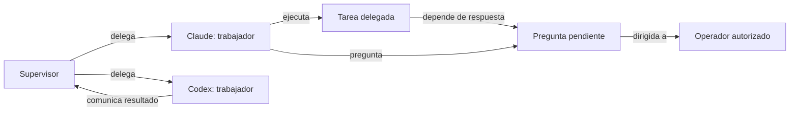

# Evidencia y composición: mapa de ejecuciones en vivo

Fecha: 2026-10-09. Alcance: análisis de fuentes y especificación; no se implementa la funcionalidad.

## Lo que confirma el usuario

Quiere visualizar ejecuciones en vivo. Cada instancia de agente será un nodo; una arista representa una relación dirigida. El mapa debe explicar quién trabaja, para quién, qué espera y cómo avanza la ejecución. La reproducción histórica y las métricas de carga son propuestas del spec, no solicitudes explícitas adicionales.

Ejemplo conceptual, sin afirmar que esta ejecución exista:

Las tareas y preguntas son expansiones auxiliares. El operador no es un agente ejecutor y la dirección de una pregunta no acredita entrega de una respuesta.

## Fuentes inspeccionadas

| Fuente | Evidencia disponible | Límite para el grafo |
| --- | --- | --- |
| [Terminal](../../src/cli_agent_orchestrator/models/terminal.py) | `id`, proveedor, perfil, `caller_id`, agrupación, incarnaciones, estado vivo, secuencias de turno | `caller_id` identifica al creador/callback; no acredita todas las delegaciones posteriores. Estado vivo no es resultado durable. Metadata libre no es autoridad. |
| [Inbox](../../src/cli_agent_orchestrator/models/inbox.py) | Mensaje con identidad, remitente, receptor, fecha y estados pending/delivered/reconcile/failed; vocabulario send_message/handoff/assign | El mensaje persistido de este modelo no contiene tipo de orquestación ni un vínculo universal a ejecución. Entrega no acredita finalización de tarea. |
| [Work](../../src/cli_agent_orchestrator/models/work.py) | Tarea, padre, intento, terminal, generación, revisión, resultado aceptado; evento con secuencia por job y página con cursor/high-water/gaps | Secuencias por job no constituyen orden global; no mezclar identidad de tarea, intento y terminal. |
| [WorkQueries](../../src/cli_agent_orchestrator/services/work_projection.py) | Lecturas en snapshot verificado, permisos y propietario; proyección separa estado de trabajo y proceso | Delegación no concede lectura de todo el job. La proyección inicial devuelve proceso unknown; hay que combinar observación de proceso sin sobrescribir estado durable. |
| [Workflow runtime](../../src/cli_agent_orchestrator/models/workflow_runtime.py) | Estados de ejecución y paso, incluidos work_pending y completed_unvalidated | Conservar distinción de trabajo admitido y resultado verificado, así como resultados no validados. |
| [API](../../src/cli_agent_orchestrator/api/main.py) | Inspección journal-first; `_event_sse_frame`, `_gap_sse_frame`, `_merge_ordered_sse_frames` y seguimiento por journal con cadencia 0,25 s | Canal por run con secuencia local, huecos declarados y cierre terminal. No es un stream universal de todas las relaciones. |
| [Seguidor web](../../web/src/components/workflow/useEventFollow.ts) | Fetch autenticado, cursor `after_seq`, frames gap y run_absent; separación de ámbito de nodo/auth | Patrón para recuperación; no acredita consistencia de un snapshot agregado nuevo. |
| [Store](../../web/src/store.ts) | Historial de workflows y generación de selección que protege respuestas tardías | El grafo necesitará preservar la misma separación de ámbitos para todas sus fuentes. |
| [WorkflowsPanel](../../web/src/components/WorkflowsPanel.tsx) | Lista de runs consultada cada 10 s; [RunDetail](../../web/src/components/workflow/RunDetail.tsx) sigue eventos | La cadencia de lista actual no satisface por sí sola el objetivo de 2 s del nuevo mapa. |
| [AgentPanel](../../web/src/components/AgentPanel.tsx) | Consulta de sesión a 5 s y estado a 3 s | Estado por consulta existente no es evento universal ni garantiza el objetivo nuevo. |
| [EventBus](../../src/cli_agent_orchestrator/services/event_bus.py) | Pub/sub en proceso, wildcard, cola acotada por configuración; salida y estado de terminal | No tiene journal/cursor/replay. Sin loop descarta publicación; QueueFull descarta eventos y registra aviso. No basta como fuente histórica o garantía de captura completa. |
| [Interacciones 016](../016-agent-interactions/spec.md) y [análisis](../016-agent-interactions/research.md) | Propuesta de identidad durable, destinatario y continuación de preguntas | No implementada. WAITING_USER_ANSWER existente solo prueba espera observada, no una pregunta con opciones o destinatario. |

Inspección estructural adicional: `graphify explain src/cli_agent_orchestrator/services/event_bus.py` confirmó nodo y vínculos de contención/configuración; las conclusiones de entrega y descarte se comprobaron leyendo el código. La exploración `graphify explain --help` se interpretó como búsqueda ambigua, no como ayuda, y no aportó evidencia. No se regeneró el grafo del código ni se confundió con el mapa de ejecuciones propuesto.

## Fronteras que debe resolver la planificación

1. **Identidad y ámbito**: elegir una identidad compuesta de servidor/origen e incarnación disponible. Vincular run, paso, Work, intento y terminal mediante datos explícitos. Una sesión tmux no equivale a una ejecución.
2. **Composición del presente**: establecer snapshot y posiciones de seguimiento coherentes por origen. Definir recuperación de creaciones/eliminaciones durante carga; prohibir sobrescritura por revisiones antiguas.
3. **Orden y causalidad**: mantener cursores por run/job/origen y vínculos causales explícitos. No restar secuencias de dos jobs ni deducir dependencias de marcas de tiempo.
4. **Captura faltante**: determinar qué delegaciones y mensajes ya tienen evidencia suficiente y cuáles necesitan registros adicionales. No depender de scraping del texto del terminal para relaciones accionables.
5. **Autorización**: componer filtros de lectura de cada recurso en servidor, incluidos extremos de aristas, conteos y búsquedas. Una vista global no amplía el permiso owner-only de Work.
6. **Recursos y congestión**: límites de nodos, aristas, seguidores y memoria; cancelación al cambiar ámbito/desmontar; recuperación ante colas llenas; considerar varios clientes y procesos de servidor.
7. **Privacidad**: el grafo ambiental contiene metadatos mínimos; contenido de mensajes o preguntas únicamente en detalles con permisos. Revocación invalida vista y caché.
8. **Disponibilidad remota**: identidad por origen y frescura independiente. El acceso al terminal respeta su mecanismo existente; no trasladar procesos ni prometer apertura de cualquier terminal remoto.
9. **Historial**: distinguir eventos durables existentes de observaciones transitorias. Definir captura/retención si se quiere reproducir el grafo completo; mostrar huecos y estados desconocidos.
10. **Interacciones**: reutilizar 016 cuando exista; mostrar antes la espera nativa limitada. El mapa no traduce un estado de espera a aprobaciones genéricas ni escribe por su propia vía.
11. **Compatibilidad y dependencia**: nueva proyección de lectura sobre dueños actuales, evitando dependencia inversa del dominio hacia API/UI. No exigir AG-UI para el mapa básico. Cambios de esquema y migraciones se decidirán en plan.
12. **Experiencia**: posiciones estables durante seguimiento, foco preservado, filtros con límites explícitos y alternativa en lista para teclado/movimiento reducido.

## Escenarios de composición previstos

- Supervisor crea dos trabajadores; uno produce pregunta obligatoria mientras otro entrega resultado. El bloqueo afecta su rama y los estados de entrega, tarea y proceso permanecen separados.
- El mismo agente ejecuta dos trabajos, con varios intentos y mensajes entre participantes. Cambiar ámbito no mezcla tareas ni respuestas tardías.
- Carga inicial simultánea con creación/eliminación, duplicado, actualización antigua, desconexión y reconexión. Convergencia o incertidumbre declarada, nunca duplicación silenciosa.
- Job revocado durante stream; endpoint de detalle y búsquedas no filtran datos fuera de permisos. Los conteos y extremos de aristas no revelan recursos ajenos.
- QueueFull o servidor reiniciado mientras cambia un estado: consultar fuentes durables recupera el presente; lo no registrado no se reconstruye como historial íntegro.
- Terminal legado sin tipo de delegación conservado, proveedor remoto desconectado o hueco del journal: declarar cobertura limitada y no fabricar relaciones.
- Navegación histórica durante cambios actuales, borrado/retención de run y ciclo real de dependencias: distinguir pasado, ausencia, incertidumbre y dependencia probada.

## Composition Review Report

- **Changed subsystems**: documentos del spec 017 y selector de feature de Spec Kit. Sin cambios de producto.
- **Neighbors reviewed**: modelos Terminal/Inbox/Work/Workflow, proyección y autorización de Work, API de historial, EventBus, seguimiento y navegación web, propuesta 016.
- **Contracts/invariants checked**: mediante lectura de fuentes, separación de estado durable/proceso, identidad y orden por origen, entrega incierta, autorización de lecturas, límites del bus y recuperación de historial.
- **Architecture checks run**: no ejecutados en este cambio documental; obligatorios en implementación según AGENTS.md. No se usa evidencia de una ejecución anterior como validación nueva.
- **Composition/integration scenarios run**: ninguno de producto; los escenarios anteriores son requisitos para plan/tareas, no pruebas aprobadas.
- **Contract tests / real dependencies**: no aplican a documentación; implementación necesitará pruebas de fuentes reales, autorización y recuperación además de pruebas visuales.
- **Failures/root causes**: ningún defecto de producto corregido; la consulta de ayuda de Graphify fue ambigua y se sustituyó por ruta explícita.
- **Residual risks**: no hay contrato agregado universal inspeccionado que entregue toda la topología. Persistencia de relaciones faltantes, retención, escala y autorización compuesta quedan para planificación. El grafo no está implementado.
- **Verdict**: PASS WITH RISKS para definición documental, condicionado a validación de documentos registrada en [checklist](checklists/requirements.md); sin veredicto de ejecución del producto.

## Decisión de conocimiento y actualización

El spec y este análisis son los artefactos durables del repositorio. No se duplica su contenido en Obsidian. No se regenera Graphify porque no cambian estructuras de código. Las comprobaciones finales deben limitarse a documentación; las pruebas de implementación seguirán el flujo spec → plan → tareas → impacto → implementación → comprobaciones.
