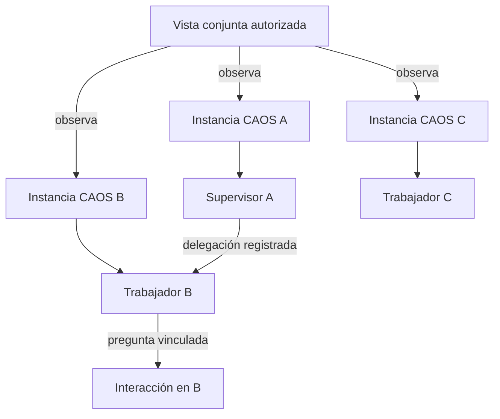

# Evidencia y composición: varias instancias CAOS

Fecha: 2026-10-09. Alcance: documentación, sin implementación ni configuración de conexiones reales.

## Flujo conceptual propuesto

La vista conjunta observa varias autoridades. Que A y B sean visibles no demuestra una relación de delegación ni autoriza a A a actuar sobre B. Los nodos de instancia agrupan agentes; no se confunden con agentes ejecutores.

## Qué existe hoy, contrastado con fuente

| Fuente | Hallazgo | Límite |
| --- | --- | --- |
| [Panel Fleet](../../examples/fleet/panel/app/main.py) | `/api/fleet` usa `asyncio.gather` para consultar salud y sesiones de todos los nodos y aislar excepciones por entrada. | Es un ejemplo ejecutable, no una proyección universal de ejecuciones distribuidas. `online` combina consulta de salud y sesiones; no equivale a cobertura completa. |
| [Configuración Fleet](../../examples/fleet/panel/app/config.py) | Registro por archivo o ConfigMap, validación de nombres/endpoints, fuentes privadas de credenciales, snapshot de registro y estado de fallback/frescura. | Nombre único de nodo es un alias del registro, no identidad criptográfica universal del servidor. Fuente del registro y observación de recursos tienen frescuras distintas. |
| [Proxy Fleet](../../examples/fleet/panel/app/main.py) | `/nodes/{name}/{path:path}` resuelve nodo registrado, valida segmentos, filtra namespaces y transmite streams; añade credenciales configuradas para el nodo. | Proxy no constituye un stream agregado ni un permiso por recurso del usuario. Su modelo de autenticación del panel es opcional/configurable; no acredita automáticamente el contrato de acceso del nuevo spec. |
| [API web](../../web/src/api.ts) | `activeNode`, `nodePath`, epoch y abort por cambio de nodo; URLs de terminal y stream vinculadas al destino elegido. | Un destino activo para consultas. No ofrece suscripciones simultáneas por instancia ni identidad cualificada universal. |
| [Store web](../../web/src/store.ts) | `selectNode` limpia sesiones, estados, runs y eventos; generaciones evitan incorporar respuestas tardías. | Adaptar a observación simultánea requiere separar estado/cancelación por conexión y lector, conservando aislamiento. |
| [Selector de nodo](../../web/src/components/NodeSwitcher.tsx) | Cambia un nodo activo y muestra disponibilidad del registro. | Seleccionar nodo no es mostrar el grafo conjunto de todos. |
| [Identidad local](../../src/cli_agent_orchestrator/services/local_peer_identity.py) | Identidad de perfil persistente, generación de proceso y firma Ed25519. | Identidad existente para coordinación local; no se presupone adoptada por todo endpoint remoto Fleet. |
| [Registro local](../../src/cli_agent_orchestrator/services/local_peer_registry.py) | Registro compartido por usuario de procesos loopback y leases de escritura por proyecto; separa instancia y generación. | Descubrimiento local, no descubrimiento de red. Un registro no es concesión de permisos. |
| [Servicio local](../../src/cli_agent_orchestrator/services/local_peer_service.py) | Pairing verifica proyecto e identidad; grants por proyecto. `list_local_peers` combina grants y procesos verificados. | Acceso limitado al proyecto/scopes concedidos; no autoriza observación de todos los recursos de otra instancia. |
| [Delegación local](../../src/cli_agent_orchestrator/services/local_peer_service.py) | `submit_task_to_peer` requiere `task:submit`, conserva task_id/source/target/request_hash, firma la petición y crea recibo local; incertidumbre de transporte pasa a reconcile. | Este transporte es loopback y no es una delegación genérica entre máquinas. Recibo de un extremo no acredita por sí solo resultado aceptado del otro. |
| [Persistencia](../../src/cli_agent_orchestrator/clients/database.py) | LocalPeerTaskModel conserva origen, destino, proyecto, task_id, principal solicitante y estado; grants y nonces separados. | Correlación útil para tareas locales coordinadas. No equivale a un journal global con orden común. |
| [Terminal remoto](../../src/cli_agent_orchestrator/services/remote_terminal_service.py) | Placement durable ligado a runtime/incarnación/launch confirmado; namespace remoto y rechazo de colisiones. | Un runtime remoto puede ser parte de la misma autoridad CAOS. No debe contarse automáticamente como otro servidor CAOS. |
| [WorkQueries](../../src/cli_agent_orchestrator/services/work_projection.py) | Lecturas owner-only con snapshot verificado y scope; delegación no da lectura job-wide. | El agregador debe conservar estos límites aunque use credenciales de servicio para conectar. |
| [Spec 017](../017-live-execution-graph/spec.md) y [016](../016-agent-interactions/spec.md) | Definen mapa por origen y preguntas con identidad/autoridad. | Son propuestas documentales, no endpoints ya implementados. |

Graphify se consultó con `graphify explain src/cli_agent_orchestrator/services/local_peer_service.py`. Identificó dependencia del registro y funciones de pairing/tareas. Sus posiciones de línea estaban desactualizadas; se contrastaron con lectura del código actual (`submit_task_to_peer` comienza en la línea 743 de la fuente inspeccionada). No se tomó el grafo como prueba de comportamiento ni se regeneró.

## Decisiones propuestas de alcance

- La feature 018 agrega observación simultánea sobre 017; no reemplaza la autoridad de cada servidor.
- El mapa admite relaciones distribuidas solamente cuando hay correlación demostrable. Dos registros parciales pueden representarse con evidencia por extremo y discrepancia visible.
- La configuración de conexión y la concesión de permisos son acciones distintas. Confianza no es transitiva.
- Respuestas a preguntas, cuando exista 016, se dirigen a la autoridad del origen con identidad y versión completas. No se añade una cola de respuestas que reintente a ciegas tras un fallo.
- Fleet, peers locales y runtime remoto tienen semánticas distintas; se integran mediante cobertura explícita sin tratarlos como un único protocolo existente.

## Fronteras para plan y tareas

1. **Identidad y alias**: decidir cómo verificar identidad de instancia en transportes existentes, detectar alias y revisar endpoints reutilizados. Definir modo legado limitado sin falsa correlación.
2. **Lectura y autoridad**: mapear lector y permisos por recurso a conexiones con credenciales de servicio. Autenticación opcional del ejemplo Fleet no demuestra autorización multiusuario adecuada para la vista propuesta.
3. **Registro y persistencia**: seleccionar dueños de configuración y referencias de credencial; conservar conexiones al reiniciar; invalidar snapshot de registro y permisos de forma independiente. No persistir secretos en metadatos del grafo.
4. **Observación concurrente**: snapshot y cursores por origen, reconexión, límites de memoria/conexiones, cancelación individual y evitar que una fuente lenta retrase las restantes. El fan-out actual espera el gather completo antes de responder; no acredita el objetivo de apertura parcial de 3 s.
5. **Correlación**: definir clave de operación y representaciones de recibos local/remoto, deduplicación, fuentes autoritativas de cada fase, divergencia y reconciliación.
6. **Interacciones**: asociar 016 a origen/lector/versión, incertidumbre de respuesta y rechazo de identificadores antiguos; el foco visual no selecciona autoridad implícita.
7. **Transporte y confianza**: verificar canal y origen antes de enviar credenciales; revisar cambios de endpoint, redirecciones y capacidades expuestas. No ampliar automáticamente los namespaces del proxy.
8. **Compatibilidad**: mecanismos de capability/version por fuente y ausencia de captura histórica; preservar interfaces mononodo. Nuevos esquemas/migraciones requieren plan explícito.
9. **Observador**: elegir ubicación y ciclo de vida del agregador y de sus cachés. Cerrar o reiniciar el observador no modifica trabajo de instancias; histórico visible sigue sujeto a permisos y retención.

## Escenarios de composición previstos

- Tres instancias, una inaccesible: las otras entregan vista parcial dentro del objetivo; errores de autenticación y red aislados por origen.
- IDs locales idénticos, alias del mismo servidor y endpoint reutilizado: identidad cualificada, deduplicación verificada y revisión de confianza.
- Delegación local con aceptación remota y timeout del recibo: estado reconcile, evidencia por extremo y cero redispatch desde observación.
- Grants de proyecto revocados y conexión de servicio aún operativa: el lector pierde sus recursos, búsqueda, conteos y extremos restringidos; el transporte conectado no recupera permisos.
- Pregunta con ID local coincidente en dos servidores: respuesta va a un único origen autorizado; fallo incierto no dispara retransmisión.
- Reinicio del observador y de un servidor, generación nueva, cambios de registro, respuestas antiguas y relojes divergentes: recuperación por origen sin mezclar presente e historial.
- Registro dinámico obsoleto o fallback y runtime remoto de un servidor: cobertura declarada sin inventar nuevas instancias ni omitir el origen real de agentes.
- Cientos de relaciones, canales congestionados y varios lectores: límites por origen, recursos liberados, cobertura parcial visible y ausencia de acciones sobre ejecución.

## Composition Review Report

- **Changed subsystems**: spec 018, análisis, checklist y selector de Spec Kit. No cambia runtime, configuración real ni permisos.
- **Neighbors reviewed**: Fleet panel/config/proxy, selección y store web, identidad/registro/servicio de peers locales, recibos persistentes, ubicación remota y proyección de Work; specs 016/017.
- **Contracts/invariants checked**: por lectura de fuentes, aislamiento de destino, identidad/generación, permisos por proyecto y propietario, deduplicación de recibos, incertidumbre de envío y distinción de autoridades.
- **Architecture checks run**: no ejecutados; cambio documental sin dependencias de código. El gate del proyecto será requerido durante implementación.
- **Composition/integration scenarios run**: ninguno de producto; lista anterior define cobertura futura. No se conectaron servidores reales.
- **Contract tests / real dependencies**: no aplican a estos documentos. La implementación requerirá varias instancias/procesos reales y validación de autorización y transporte además de dobles controlados.
- **Failures/root causes**: ningún defecto corregido. Hallazgos: frontend con un único nodo activo y ausencia de identidad universal demostrada para todos los endpoints Fleet.
- **Residual risks**: agregado de lectura con credenciales de servicio, capacidades/versionado, recuperación consistente y latencia de nodos lentos se deben resolver en plan. No está implementado el grafo conjunto.
- **Verdict**: PASS WITH RISKS para la definición documental, condicionado a validación de estructura/enlaces del [checklist](checklists/requirements.md); no acredita funcionamiento multiinstancia nuevo.

## Conocimiento durable

Los documentos de esta feature conservan requisitos y evidencia; no se duplican en Obsidian ni se actualiza Graphify, ya que no cambia la estructura de código. La implementación seguirá spec → plan → tareas → impacto → código → comprobaciones del proyecto.
